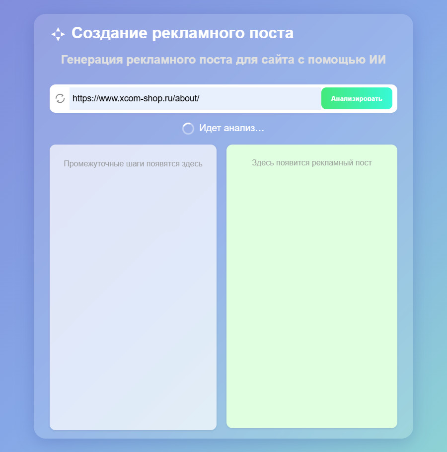
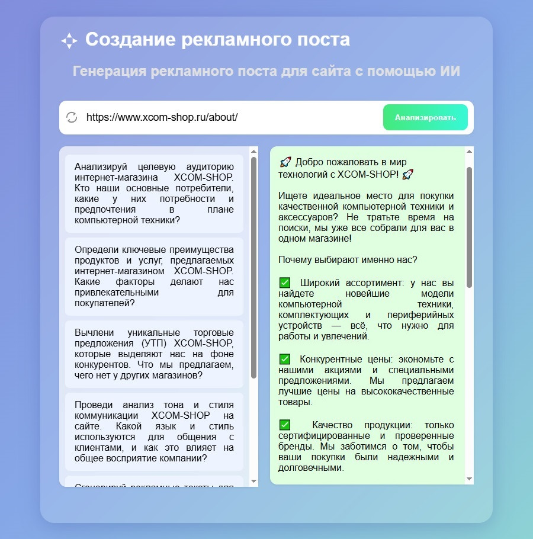

# AI Multi-Agent Ad Generator

Веб-приложение на Flask, которое анализирует содержимое сайта по URL и генерирует готовый рекламный пост с помощью последовательной работы нескольких AI-агентов.

Система использует OpenAI API и многоагентный pipeline: сначала автоматически создаются специализированные промпты, затем каждый агент выполняет свой анализ, после чего формируется итоговый рекламный текст.

## Возможности

- Парсинг и очистка текста с любой веб-страницы (BeautifulSoup)
- Автоматическая генерация 5–6 системных промптов под конкретный сайт
- Многоагентный анализ:
  - Целевая аудитория
  - Преимущества продукта / услуги
  - Уникальные торговые предложения (УТП)
  - Тон и стиль коммуникации
  - Генерация рекламных идей
- Сборка финального рекламного поста на основе результатов всех агентов
- Простой веб-интерфейс для ввода URL и просмотра промежуточных + итоговых результатов

## Как это работает

1. Пользователь вводит URL сайта.
2. Приложение загружает страницу, извлекает чистый текст и обрезает его (до ~3000 символов).
3. Первый агент анализирует текст и генерирует 5–6 специализированных системных промптов.
4. Каждый сгенерированный промпт запускается как отдельный агент — результаты собираются.
5. Финальный агент на основе всех предыдущих выводов создаёт готовый рекламный пост.

**Стартовая страница**



**Результат работы**



## 🛠️ Используемые технологии

- **Python 3.10+**
- **Flask**
- **OpenAI API (gpt-4o)**
- **Requests + HTTPX**
- **BeautifulSoup4**
- **Pydantic**
- **dotenv**

## Структура проекта

├── templates/
│   └── index.html          # Веб-интерфейс
├── static/
│   └── style.css           # Стили
├── .env.example            # Пример переменных окружения
├── .env                    # Реальные ключи (не коммитить)
├── .gitignore
├── main.py                 # Flask-приложение и маршруты
├── openai_module.py        # Логика агентов и генерации
├── openai_template.py      # Обёртка над OpenAI API
├── requirements.txt
└── README.md

## Установка и запуск

### Требования

- Python 3.10 или выше
- Аккаунт и API-ключ на [ProxyAPI](https://proxyapi.ru) (или любом OpenAI-совместимом провайдере)
- Git

### 1. Клонирование репозитория

```bash
git clone https://github.com/your-username/AI-Multi-Agent-Ad-Generator.git
cd AI-Multi-Agent-Ad-Generator
```

### 2. Создание и активация виртуального окружения

**Linux / macOS:**
```bash
python3 -m venv venv
source venv/bin/activate
```

**Windows (Command Prompt):**
```bash
python -m venv venv
venv\Scripts\activate.bat
```

**Windows (PowerShell):**
```bash
python -m venv venv
venv\Scripts\Activate.ps1
```

После активации в начале строки терминала должен появиться префикс `(venv)`.

### 3. Установка зависимостей

Создайте файл `requirements.txt` в корне проекта (если его ещё нет):

flask>=3.0.0
openai>=1.30.0
requests>=2.31.0
beautifulsoup4>=4.12.0
python-dotenv>=1.0.0
httpx>=0.27.0
pydantic>=2.0.0
python-dotenv>=1.0.0

Установите пакеты:

```bash
pip install --upgrade pip
pip install -r requirements.txt
```

### 4. Настройка переменных окружения

Создайте файл `.env` в корне проекта:

PROXYAPI_KEY=ваш_реальный_ключ_от_proxyapi
OPENAI_BASE_URL=https://api.proxyapi.ru/openai/v1

Пример содержимого `.gitignore`:

.env
venv/
__pycache__/
*.pyc
.DS_Store

### 5. Запуск приложения

```bash
python main.py
```

или

```bash
flask --app main run --host=0.0.0.0 --port=5000
```

После запуска вы увидите сообщение примерно такого вида:

 * Running on http://0.0.0.0:5000
 * Debug mode: on

Откройте в браузере:

- Локально: http://127.0.0.1:5000
- В локальной сети: `http://<ваш-ip>:5000`

### 6. Проверка работоспособности

1. Откройте главную страницу.
2. Вставьте любой публичный URL (например, `https://example.com`).
3. Нажмите кнопку генерации.
4. Дождитесь завершения работы всех агентов (это может занять 30–90 секунд в зависимости от скорости API).
5. Проверьте, что отображаются:
   - сгенерированные промпты,
   - результаты анализа каждого агента,
   - итоговый рекламный пост.

## Использование

1. Откройте главную страницу приложения.
2. Вставьте URL сайта, который нужно проанализировать.
3. Нажмите кнопку генерации.
4. Дождитесь завершения работы всех агентов.
5. Просмотрите:
   - сгенерированные промпты,
   - результаты анализа каждого агента,
   - итоговый рекламный пост.

## Лицензия

MIT
